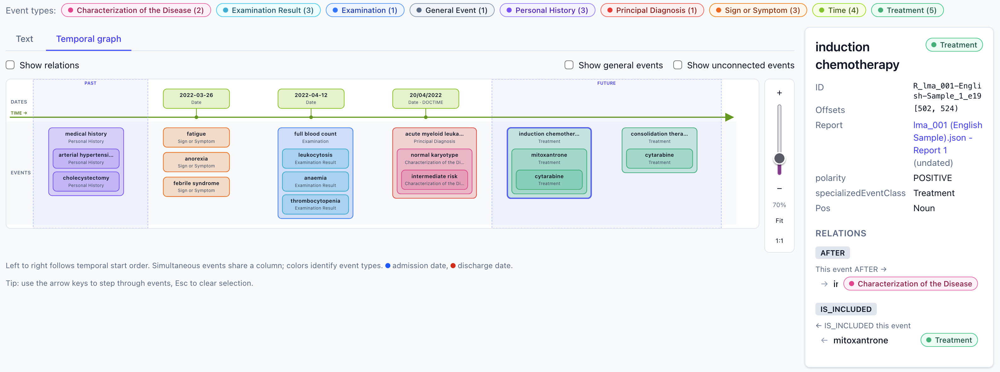

# MedTimeStories
MedTimeStories is an end-to-end system for modelling and visualising the clinical timelines of patients with Acute Myeloid Leukaemia, based on the temporal annotations defined by the Med2Story Temporal Annotation Scheme (see "Annotation" Section of this Github).
The platform was developed in collaboration with haematologists to address the specific needs of this clinical setting.


The demo provides patient timelines, annotated report views, temporal graphs,
dataset-level relation patterns, and a word graph for exploring recurring
event and relation structures.

 

## Quick start

1. Put INCEpTION UIMA CAS JSON exports in a folder, for example `inception/`.
2. Run the image with that folder mounted at `/inception`:

```bash
docker run --rm -p 8080:80 -v "$(pwd)/inception:/inception:ro" medstories
```

3. Open [http://localhost:8080](http://localhost:8080).

### Docker Compose

From the repository, build and start the demo with:

```bash
docker compose up --build -d
docker compose restart medtimestories
docker compose down
```

If no input files are available, the application starts with a bundled example
dataset.

## Main views

- **Patients**: search patients and inspect report-level statistics.
- **Patient page**: follow the report sequence, cross-report relations, and
  the merged patient timeline.
- **Report view**: read annotated text, inspect event attributes, and explore
  temporal relations.
- **Patterns**: aggregate relations as source event type, relation type, and
  target event type.
- **Word graph**: inspect event surface forms and their temporal connections
  across the dataset.

## Input data

Each INCEpTION CAS JSON file represents one patient whose clinical narrative
was annotated according to the Med2Story annotation scheme. The annotations
include clinical events, temporal expressions, event attributes, and temporal
relations. Reports within a file are separated by two consecutive newline
characters (`\n\n`), which the converter uses to reconstruct the report
sequence for the demo.

Med2Story is described by Fernandes et al.:

> Fernandes, A. L., Silvano, P., Leal, A., Guimarães, N., Rb-Silva, R., Cunha,
> L. F., & Jorge, A. (2025). [The incremental process of building an
> annotation scheme for clinical narratives in Portuguese: The contribution of
> human variation analysis](https://aclanthology.org/2025.law-1.28/). In
> *Proceedings of the 19th Linguistic Annotation Workshop (LAW-XIX-2025)*
> (pp. 332–343). Association for Computational Linguistics.


## Development

```bash
npm install
npm run dev        # http://localhost:5173
npm run build      # type-check and production build
```

## File structure

```text
.
├── Annotation/              Med2Story annotation guidelines
├── demo/                    Interactive visualisation application
├── llm-pipeline/            LLM-based annotation pipeline
└── README.md                Project documentation
```


## Responsible use

Clinical narratives may contain sensitive personal information. Input data
must be de-identified and processed only under the appropriate institutional
and legal approvals. The application is intended for research and
visualisation; its outputs do not replace clinical judgement, validated
clinical software, or formal statistical analysis.
